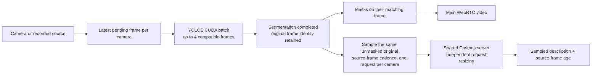

# Main-video masks with frame-matched descriptions

The `/multi-camera` workspace shows **Masks on main video**. Each returned
frame contains YOLOE masks computed from that same frame. VLM descriptions
sample the original, unmasked version only after its segmentation completes.
The main video continues while the VLM generates the description; the UI labels
these results **VLM Output** and displays the age of the observed frame.
There is no separate segmentation inset in the current workspace.

## Start the recorded demonstration

Start with the [Thor installation guide](../setup/thor-deployment.md) to prepare
the application and configure a VLM endpoint. The optional
[Cosmos setup](cosmos-edge-demo.md) describes using a local Cosmos server.
Open **https://JETSON_IP:8090/multi-camera**, using your Jetson’s address,
or **https://localhost:8090/multi-camera** in a browser on that Jetson. Accept the development certificate, select two or four
cameras, choose **Store demo**, and keep segmentation and **Live descriptions**
enabled. Use **Fast actions** for 32-token descriptions with a 512-pixel maximum
VLM image edge and temperature 0, then click **Start cameras**. Each camera can
override the shared prompt and keeps its own responses and recent observations.
The deployed retail profile suggests **5% Confidence**, including when recorded
clips are selected manually. This reduces intermittent missing masks in these
close-up recordings. It can also admit more false detections; adjust Confidence
for the intended camera scene. Manual choices survive model checks and preset
selection. The generic PyTorch store preset suggests 10%, and the general JSON
API default remains 25%.

The current realtime launch uses a 640×360 playback bound for the complete
recorded frame; it feeds both segmentation and VLM sampling and fills the
normal main-video tile. The UI states that bound separately from each model's
analysis size. `LIVE_VLM_DEMO_MAX_SIZE=960x540` restores the larger default
playback size at the next application launch. See the
[retail runtime settings](segmentation.md#build-the-optimized-retail-model-on-the-destination-thor).

The four preferred Pexels recordings, `store-25-1` through `store-25-4`, provide
native 25 FPS input. Earlier Intel `retail-*` clips remain available at their
native 24 FPS. Replay is capped at 25 FPS and keeps output timestamps monotonic
across loops; slower clips are not duplicated to meet that cap. These are recorded demonstrations, not synchronized physical
cameras or a live Micro Center installation. See [footage setup, available
clips, and attribution](retail-demo.md).

Settings remain visible when streams connect. Select **Focus view** to give
the videos more room on the tested desktop layout; **Show settings** returns
to configuration, custom prompts, and history. **Stop all** remains available. Source and inference
changes apply after stopping and starting a new session. Stopping releases the
camera resources and clears video, progress, and freshness indicators.

## Frame identity and independent analysis sizes

For segmented playback, a source frame first completes YOLOE segmentation.
The server publishes its masked counterpart to the camera's preview, then
considers its original pixels for a VLM sample. A frame dropped before
segmentation completes is not sampled by that camera's VLM. Sampling cadence
uses the source-frame counter, including frames skipped by segmentation, and
busy cameras keep no backlog of VLM samples.

The two models may resize this same source frame independently. YOLOE's
`imgsz` controls its inference tensor; Cosmos's `image_max_edge` controls its
image request. Different tensor dimensions do not mean different source frames.
Masks are composited on their original frame dimensions and preserve its
`pts` and `time_base`. Cosmos receives the original without the green overlay.

By the time a description finishes, the video may have advanced to later
frames. The description therefore refers to its sampled frame, identified by
metadata and **Observed … s ago**, rather than to every frame currently playing.
A 25 FPS video or mask target does not mean 25 VLM descriptions per second.

## Read the separate indicators

| Indicator | What it measures |
| --- | --- |
| **Video … FPS** | Browser video-frame counter change over roughly one second. |
| **Analyzed … FPS** | Completed YOLOE analyses for that camera over a rolling window of up to 125 completions, including frames with no detected masks. |
| **Analyzing** | This camera has a VLM request pending or running. |
| **Observed … s ago** | Age of the frame behind the latest successful description, including inference time and elapsed time since completion. |
| **Full result** | Server frame receipt to complete VLM answer, including preparation and shared-slot waiting. |
| **Queue** / **Request** | Shared VLM slot wait, then image/JPEG preparation and the complete model request after admission. |

The mask target defaults to 25 FPS and caps submission rate; actual completion
and decoded-video rates must be measured. If the GPU cannot keep up, older
pending frames are replaced rather than replaying masks or duplicating video
frames to inflate the rate. Main-video delivery is limited by segmentation
completion, source rate, and WebRTC/browser capacity. It does not wait for a
VLM response.

Freshness continues advancing during another request and after reconnecting to
the results socket. Ages begin at server receipt, excluding physical capture
and camera-to-server transport. Descriptions can misidentify small objects,
partly visible people, or actions; a timestamp establishes frame identity, not
semantic accuracy.

## Shared model serving

All cameras share one Cosmos server with up to four concurrent requests, and
one YOLOE checkpoint/predictor with compatible batches of up to four frames.
Each camera retains separate inputs and results. The current optimized retail
launch uses a fixed-label TensorRT engine; its object list and analysis size are
shown and locked in setup. The optional configurable PyTorch launch reuses its
model across object-label sets and caches only their embeddings. Additional
cameras or sessions do not create additional model replicas. See the
[retail engine launch](segmentation.md#optimized-retail-model-on-this-thor). See
[model sharing and request isolation](cosmos-edge-demo.md#one-serving-instance-per-model).

## API frame correlation

The browser explicitly sends `"preview_mode": "segmented"`, also the API
default when that field is omitted. Session snapshots report the mode.
Results carry both `session_id` and `camera_id`; within that camera, correlate
completed mask and description events using these fields:

| `segmentation_result.metrics` | `vlm_response.metrics` | Meaning |
| --- | --- | --- |
| `frame_id` | `last_frame_id` | Source-frame counter, including frames skipped by segmentation. |
| `frame_pts` | `last_frame_pts` | Original frame presentation timestamp. |
| `frame_time_base` | `last_frame_time_base` | Timestamp units, encoded as a rational string when available. |
| `frame_received_unix_ms` | `last_frame_received_unix_ms` | Receipt time of that exact original at the server. |
| `frame_age_ms` | `last_e2e_latency_ms` | Receipt-to-mask-completion age or receipt-to-complete-description time, respectively. |

`last_frame_preview_mode` is `"segmented"` for a sample admitted after its
segmentation completes. If segmentation fails for a camera, its preview falls
back to raw video and subsequent VLM samples are explicitly tagged `"raw"`.
Other cameras continue independently. Processing can start before a viewer
connects; frame identity establishes which completed analysis the preview would
publish, not proof that a remote browser displayed a particular frame.

The result socket emits per-camera `vlm_status` events with `is_processing`.
Successful description metrics include dynamically updated
`observation_age_ms`; in-flight work does not relabel the previous completed
result's identity or receipt timestamp. See [the multi-camera API](multi-camera.md)
for lifecycle, timing, and camera offers.

For older custom clients, `preview_mode: "smooth"` remains supported by the
backend. It publishes independent raw video and optional matched JPEG analysis
snapshots, and samples VLM frames directly from the raw source. The current
browser does not expose that mode or render its snapshots.

## Validation status and measurement scope

The frame-alignment regression checks pass with synthetic cameras and delayed
analysis: no VLM sample is admitted before segmentation completes, masked
previews advance while descriptions wait, and completed descriptions retain
the exact original pixels and matching frame metadata. These checks establish
routing and lifecycle behavior; they do not establish GPU throughput.

The October 6, 2026 combined browser checks used the four native-25-FPS
Pexels clips, one fixed-retail TensorRT YOLOE-26 Small engine with CPU mask
postprocessing, and one Cosmos3-Nano INT4 Edge-LLM server. Settings were masks
on main video, 25 FPS target, 10% confidence, 45% opacity, and Fast actions
(32 tokens, 512-pixel VLM edge, temperature 0, sample every 25 source frames).
Each run had 10 seconds of warmup followed by 30 seconds of measurement in a
1600×1200 browser on this Jetson; every tile remained fully in view.

| Streams / whole-frame playback | Completed masks FPS per stream | Browser decoded FPS per stream | Dropped-adjusted presentation estimate | Full VLM result p50 / p95 |
| --- | ---: | ---: | ---: | ---: |
| 2 / 640×360 | 25.00 | 25.00 | 24.90–24.96 | 764 / 878 ms |
| 4 / 640×360 | 24.30–24.46 | 24.33–24.46 | 23.90–24.30 | 1,046 / 1,285 ms |
| 4 / 960×540 | 19.83–19.86 | 19.83–19.86 | 19.30–19.63 | 1,065 / 1,299 ms |

The current LAN launch uses **640×360**. Two-stream mask and decoded-video
rates were 24.9975 FPS (rounded to 25.00 above). Four streams approach the
25 FPS target but do not sustain exactly 25 completed masks per second, and
not every VLM answer completes within one second. The four-stream 640×360 run
had 113 complete answers: 35 within one second, maximum 1,423 ms. All 60 answers
in the two-stream run finished within one second, maximum 901 ms. These are
short measured runs, not a sustained performance guarantee.

All three runs passed functional checks. Every measured VLM response matched
its camera's completed segmentation frame ID, PTS, time base, and original
receipt timestamp: 60/60 for two streams, 113/113 for four at 640×360, and
113/113 for four at 960×540. Mask frame IDs were unique and strictly increasing;
no mask was repeated to inflate the rate. Each camera produced masks and
independent descriptions, controls remained usable, and stopping removed the
sessions and cleared video/progress indicators without JavaScript or VLM errors.
The final unit/integration suite passed **301 tests**.

The engine also passed batch 1/2/4 and portrait-input checks while retaining
one model/predictor. Eight representative store frames at each playback size
matched the same-checkpoint PyTorch mask unions with minimum IoU 0.9727 at
960×540 and 0.99985 at 640×360; these comparisons verify the accelerated
implementation, not the model's detection accuracy. The CPU/GPU postprocessing
comparison had identical mask pixels and counts on its eight test frames.

[Measurement summary and individual reports](../../artifacts/25fps/final-summary.json)
include raw browser/frame events, screenshots, and correctness evidence under
`artifacts/25fps/`. Frame identity and source cadence were tested independently
of FPS targets. Recorded sources loop and are not synchronized physical cameras;
remote-network and physical-camera performance were not measured.

Browser FPS should use video-quality counter differences over the measured
window, alongside dropped/presented counters and callback gaps. Keep every
video tile fully in the viewport throughout measurement. Complete VLM latency
must include preparation, queue waiting, and the complete answer; it is not
time to first token. Server metrics exclude physical capture and browser
painting. Report warmup, duration, source clips, model settings, and per-camera
results so earlier and current runs remain distinguishable.

## Historical visible-browser comparison — October 5, 2026

These runs preceded the current main-video-only UI and completed-frame VLM
admission. Their smooth-mode insets and independent raw-frame VLM sampling
describe the earlier implementation. Retained numbers establish that earlier
behavior only; they do not validate the current native-25-FPS demonstration.

The four-view comparison used the same four looping retail excerpts, 640-pixel
YOLOE inference, Store demo classes, and Fast actions (512-pixel VLM edge,
32-token cap, temperature 0, sampling every 25 source frames). Each mode had a
10-second warmup followed by a 30-second measurement. A separate two-view
smooth-mode check used a 5-second warmup and a shorter 15-second measurement.

All videos were fully inside the **1600×1200 desktop viewport** at both
measurement boundaries and every 250 ms geometry sample: 120 samples per video
for each four-view run and 60 per video for the two-view run. Both four-view
modes and the two-view run passed all functional checks. The screenshot also
showed all four tiles, matching-mask insets, and independent descriptions.

| Mode | Browser decoded FPS per view | Dropped-adjusted estimate | Presented-counter FPS | Largest observed callback gap per view |
| --- | ---: | ---: | ---: | ---: |
| Four views, smooth | 24.00 | 23.50–23.83 | 23.52–23.83 | 100–133 ms |
| Four views, masks on video | 11.07–11.13 | 11.07–11.13 | 11.06–11.12 | 167–200 ms |
| Two views, smooth | 24.00 | 23.53–23.66 | 23.57 | 100–133 ms |

The decoded and dropped-adjusted figures use browser video-quality counters;
the presented counter comes from callback metadata over its first-to-last
callback interval. Callback invocation rates were sometimes lower because a
callback could report several new presentations. Its gap therefore is a
callback gap, not a physical display-frame gap. These headless browser counters
support improved visible-layout playback but do not measure physical display
photons or prove every decoded frame was shown. In the four-view smooth run,
each video dropped 5–15 frames across the 30-second window.

Analysis rates remain independent of main-video playback:

| Mode | Completed mask FPS per view | Loaded inset images/s per view | Complete VLM answers, all views | Pooled server-frame-to-answer p50 / p95 |
| --- | ---: | ---: | ---: | ---: |
| Four views, smooth | 8.57–8.87 | 3.83–3.87 | 107 in 30 s | 1,060 / 1,326 ms |
| Four views, masks on video | 11.07–11.10 | No separate inset | 105 in 30 s | 1,078 / 1,362 ms |
| Two views, smooth | 18.46–18.66 | 4.33–4.40 | 28 in 15 s | 789 / 853 ms |

These latency percentiles pool individual complete responses across the views,
using linear interpolation. In four-view smooth mode, 31 of 107 answers
completed within one second; the maximum was 1,472 ms. All 28 answers in the
shorter two-view run completed within one second, with a maximum of 857 ms.
That shorter check is not a sustained latency guarantee. The timing starts at
server frame receipt and includes preparation and queue waiting, while excluding
physical capture, camera-to-server transport, and browser delivery.

Setup/presentation controls responded while inference was active, then returned
to compact view before measurement. Their measured toggle completion was about
39–44 ms; **Stop all** returned to idle in about 122–152 ms. All sessions were
removed through the UI, video/snapshot/progress indicators cleared, and no
JavaScript or VLM errors were recorded. Every camera received positive masks,
matching loaded snapshot images in smooth mode, its own descriptions, and
visible progress/freshness indicators. The backend regression suite passed
**224 tests**.

The completed reports, geometry samples, raw frame/event records, and screenshots
are available in
[`visible-comparison`](../../artifacts/realtime-demo/visible-comparison/benchmark-report.json)
and [`two-camera`](../../artifacts/realtime-demo/two-camera/benchmark-report.json).
These are short same-machine recorded-video checks; they do not establish
physical-camera, remote-network, long-duration, or semantic model accuracy.
The native footage supplies only 24 fresh frames/s.

**The exact 25 FPS segmentation plus complete one-second VLM target was not
met for four views in these historical runs.** Their smooth mode improved
main-video playback by separating it from analysis; it did not increase the
measured mask-inference rate or make every answer finish within one second.

The initial run in `artifacts/realtime-demo/comparison/` remains a preliminary
offscreen-layout test: cameras 3 and 4 were outside the viewport, with dropped
video counters close to their total frame counts. Its functional pass predated
the geometry checks. It is superseded by the visible-layout runs above and
must not be presented as completed proof of four visible smooth videos.

## Mask continuity correction — October 8, 2026 UTC

A screen recording showed multi-second gaps in green masks while the underlying
video continued moving. The normal browser setup used 25% confidence, whereas
the previous Store demo preset used 10%. The FPS indicator counted analyses
with zero detections, so 25 FPS did not mean a mask was found on every frame.

A controlled four-clip, segmentation-only comparison processed approximately
400 frames per camera per threshold at about 25 FPS. At 25% confidence, frames
with any mask were 40.6%, 49.6%, 81.5%, and 5.0%; at 10%, 88.3%, 97.2%, 100%,
and 74.4%; at 5%, 100%, 100%, 100%, and 99.5%. The 5% recommendation applies
to this retail engine, with no mask reuse across frames and no extra model copy.
These figures measure mask presence, not object recall or segmentation accuracy.

In a separate 30-second four-stream browser run with Cosmos also active, the
5% setting produced masks on 100%, 100%, 100%, and 99.4% of completed analyses.
Segmentation completion was 23.5–23.6 FPS per camera and browser presentation
was about 23.1 FPS. The four-stream combined workload still falls short of a
guaranteed 25 FPS. Evidence is retained locally under
`artifacts/segmentation-cadence/threshold-summary.json` and
`artifacts/segmentation-cadence/combined-5pct/`; the earlier 10% performance
measurements above remain historical.

After deployment, a 30-second browser run selected the two recorded sources
manually, without the Store demo preset or a confidence override. The request
used the recommended `0.05` automatically and kept the default 30-frame VLM
sampling interval. Each camera completed 750 analyses (25.0 FPS), with zero
empty-mask results and zero skipped source frames in that interval. Browser
presentation was approximately 24.9 and 24.7 FPS. This confirms the normal
configuration path as well as the preset. See
`artifacts/segmentation-cadence/deployed-manual-2cam/` and
`artifacts/segmentation-cadence/validation-summary.json`. The change passed
137 focused regression tests plus browser/profile checks; manual confidence
choices remain preserved.
