# YOLOE-26 segmentation on Jetson Thor

The browser uses **Masks on main video**, with each mask composited on the frame
that produced it. There is no separate inset. VLM descriptions sample that same
frame's original pixels after segmentation completes; video continues while the
description runs. See [frame alignment and viewing indicators](realtime-demo.md).
The API defaults to `preview_mode: "segmented"`; older custom clients may still
request `smooth`.

The `/multi-camera` workspace supports two or four independent camera streams
with YOLOE-26 Small segmentation. It displays translucent masks over the matching
video frame, without bounding boxes or labels. The configurable PyTorch defaults cover `person`, `car`,
`truck`, `bus`, `bicycle`, and `motorcycle`; the object names, confidence, and mask
opacity can be changed before starting a session.

Segmentation runs locally on CUDA. Live VLM descriptions are optional and keep
separate per-camera prompts and results, with admission aligned to completed
segmentation frames in the normal main-video mode. Disable **Live descriptions**
in the workspace to use segmentation without a VLM server. The legacy
single-camera page remains available at `/`.

## Run on another Jetson Thor

Run these commands from the repository checkout containing the multi-stream
feature. The [Thor deployment guide](../setup/thor-deployment.md) covers the full
installation and optional local Cosmos server. Images, weights, runtime libraries,
and TensorRT engines are downloaded or built on the new Jetson; no files from
another machine or previously generated `artifacts/` directory are required.

Prerequisites are an aarch64 Jetson Thor with a compatible NVIDIA driver,
Docker configured with the NVIDIA runtime, and network access for the first
image/weight download. The validated machine is a Thor T5000 on L4T 39.2.1;
other JetPack/runtime combinations require a GPU smoke test. The source is
mounted into an isolated container, without changing host Python/CUDA packages.

```bash
# Inspect the plan first; this does not download, build, or run anything.
./scripts/run_segmentation_thor.sh --dry-run

# Download checksum-verified official weights and build the application image.
./scripts/run_segmentation_thor.sh --prepare

# Check local prerequisites without starting a container.
./scripts/run_segmentation_thor.sh --check

# Start with customizable PyTorch segmentation; use the new Jetson's address.
./scripts/run_segmentation_thor.sh --skip-build --host 0.0.0.0 --port 8090
```

Open `https://JETSON_IP:8090/multi-camera`, accept the development certificate,
select two or four streams, and start. **Browser camera** reads cameras on
whichever computer runs the browser and requires browser camera permission.
**Jetson USB camera** reads cameras connected directly to the Jetson, even from
a remote laptop: click **USB cameras**, then **Start**. Connect the
cameras before launching the runner; it maps attached USB video devices and
their group permissions automatically. Recreate the app container after adding
cameras. Use the RTSP source for network cameras.
Disable VLM inference in the UI if a VLM server has not been configured yet.

The default runner binds to `127.0.0.1`; `--host 0.0.0.0` explicitly enables LAN
access. Application arguments such as `--port`, `--api-base`, `--model`, and
`--vlm-backend` are forwarded unchanged. For example, connect to an existing
local Cosmos endpoint with:

```bash
./scripts/run_segmentation_thor.sh --skip-build --host 0.0.0.0 \
  --api-base http://127.0.0.1:8012/v1 \
  --model cosmos-nano-int4 --vlm-backend edgellm
```

The first session prepares the model before returning success. The UI reports
missing dependencies or CUDA rather than silently switching segmentation to
CPU. The runner creates no system service and does not stop existing containers.
Ctrl+C stops this foreground server and releases its sessions.

### Files and configuration

| Variable | Default / purpose |
| --- | --- |
| `LIVE_VLM_SEGMENTATION_IMAGE` | `live-vlm-webui:segmentation-thor`; image built/reused by the runner. |
| `LIVE_VLM_SEGMENTATION_BASE_IMAGE` | Optional override for the pinned GPU base in the Dockerfile; revalidate CUDA/torch compatibility after changing it. |
| `LIVE_VLM_MODEL_DIR` | Checkout `.models`; checksum-verified checkpoint and encoder, mounted read-only. |
| `LIVE_VLM_STATE_DIR` | Checkout `artifacts/segmentation`; writable `config/` and `cache/`, including the development certificate. |
| `LIVE_VLM_SEGMENTATION_ENGINE` | Optional absolute or relative path to a retail `.engine` built for this target/runtime. |
| `LIVE_VLM_TRT_RUNTIME_PREFIX` | Optional TensorRT extraction prefix override; used with `LIVE_VLM_TRT_CUDA_ROOT`. Retail defaults to the prepared checkout `.models/thor-runtime`. |
| `LIVE_VLM_TRT_CUDA_ROOT` | Optional matching CUDA directory override; the prepared default is `.models/thor-runtime/usr/local/cuda-13.2`. |
| `LIVE_VLM_TRT_IN_IMAGE` | `1` only if the selected image already contains the matching TensorRT/CUDA runtime. |
| `LIVE_VLM_DEMO_MAX_SIZE` | Optional recorded-video playback bound, e.g. `640x360`. |

Paths are relative to the invoking directory or absolute; the checkout itself
is located relative to the script. Paths with spaces are supported. The
container runs as the caller's UID/GID. Docker alone can use passwordless sudo;
model downloads and generated files remain owned by the caller.

`--prepare` does not start the application. `--skip-build` reuses an existing
image and verifies local assets; a missing weight can still be downloaded.
`--check` never downloads, builds, creates directories, or starts a container.
It checks Docker access/NVIDIA runtime registration, image presence, local
model hashes (or engine presence), and explicitly selected runtime paths. This
is a prerequisite check, not proof that a GPU engine can deserialize or infer.
`--dry-run` prints shell-escaped commands without contacting Docker or changing
files. Use `--runner-help` for runner options; `--help` goes to the application.

## Build the optimized retail model on the destination Thor

The retail TensorRT version uses the same YOLOE-26 Small checkpoint, with fixed
labels `person`, `shopping cart`, `shopping basket`, and `backpack`. It accepts
batches one through four and a fixed 288×480 inference tensor. Each source frame
is letterboxed for inference; masks are restored to that source frame's size.
The main video and VLM sampling retain the matching original frame.

The application loads **one** segmentation backend at launch. A retail engine
never silently falls back to PyTorch or loads a second segmentation model. Its
UI locks the objects and 480-pixel analysis setting. Confidence, detection
limit, and opacity remain adjustable; incompatible API settings fail explicitly.
Unset `LIVE_VLM_SEGMENTATION_ENGINE` to use configurable labels with PyTorch.

TensorRT engines are not portable source artifacts: build on the destination
GPU using the same runtime used for serving. The validated export requires
TensorRT **10.16.2.10** (both Python bindings and native libraries), CUDA 13.2
runtime libraries, Python 3.12, ONNX **1.19.1**, and Ultralytics **8.4.173**.
The pinned application base provides PyTorch **2.11.0+cu130**; the Dockerfile
installs the export dependencies.

Prepare the optional native runtime directly from NVIDIA's public package
repositories. This step is unnecessary for the default PyTorch mode:

```bash
# Optional: inspect the exact pinned package URLs, hashes and download size.
python3 scripts/prepare_segmentation_runtime.py --dry-run

# Download about 2.85 GB and extract to checkout/.models/thor-runtime.
python3 scripts/prepare_segmentation_runtime.py
python3 scripts/prepare_segmentation_runtime.py --check

./scripts/run_segmentation_thor.sh --prepare
./scripts/run_segmentation_thor.sh --skip-build \
  --export-engine "$PWD/.models/retail-480.engine"

export LIVE_VLM_SEGMENTATION_ENGINE="$PWD/.models/retail-480.engine"
./scripts/run_segmentation_thor.sh --check
./scripts/run_segmentation_thor.sh --skip-build --host 0.0.0.0 \
  --api-base http://127.0.0.1:8012/v1 \
  --model cosmos-nano-int4 --vlm-backend edgellm
```

The bootstrap requires Python 3, `curl` and `dpkg-deb`. It verifies every package
against SHA256 hashes pinned in `scripts/thor_runtime_packages.json`, then
extracts into a temporary directory and publishes the complete prefix only
when all required files exist. Cached downloads are verified before reuse.
Interrupted downloads or extraction do not become a usable runtime. Existing
invalid files are reported rather than silently overwritten. `--check` and
`--dry-run` perform no network requests or writes.

TensorRT packages come from NVIDIA's
[Jetson R39.2 repository](https://repo.download.nvidia.com/jetson/common/dists/r39.2/main/binary-arm64/Packages.gz);
CUDA runtime/math libraries and headers come from its
[Ubuntu 24.04 ARM64 SBSA repository](https://developer.download.nvidia.com/compute/cuda/repos/ubuntu2404/sbsa/).
The checked-in manifest records the exact official URLs, versions and published
hashes. The setup extracts packages without root privileges or package maintainer
scripts; it does not install them as host packages. It does not replace the
Jetson driver or configure a system CUDA installation.

Retail export/launch automatically uses the prepared repository-private prefix.
TensorRT is under `usr/lib/aarch64-linux-gnu` and
`usr/lib/python3.12/dist-packages`; matching CUDA libraries and headers are
under `usr/local/cuda-13.2`. The runner mounts both read-only in the container.
A default PyTorch launch does not mount this optional runtime.

For a different private location, pass `--prefix /path/to/private-runtime` to
the bootstrap and set `LIVE_VLM_TRT_RUNTIME_PREFIX` to that path and
`LIVE_VLM_TRT_CUDA_ROOT` to its `usr/local/cuda-13.2` subdirectory when running
the exporter/application. Use `--cache-dir` to relocate download storage; it
must be outside the runtime prefix. `LIVE_VLM_TRT_IN_IMAGE=1` remains available
for a custom image containing the exact matching runtime. The same runtime
selection must be used during export and serving.

Export uses the same image and read-only runtime mounts as serving, with a
separate writable output directory. It does not start a web server. It verifies
the official checkpoint/encoder hashes, bakes the retail prompts, builds FP16
TensorRT tactics with mixed-precision fallback, and checks engine metadata and
input profiles. ONNX, prompt embeddings and a JSON build receipt accompany
the engine. Output files must not already exist; choose a new name, or pass
`--force` deliberately. Never replace an engine mounted by a running server.
The Python exporter also supports `--check` to probe its dependencies/GPU
without exporting; see `scripts/export_retail_segmentation.py --help`.

After export, verify segmentation on representative feeds before relying on a
frame-rate target. A new engine digest is expected on another target. Historical
local engine hash `489f06f684e1482697224dd30482523f50a7040a739ac5206afeedd27520c9f0`
identifies the prior T5000/L4T39.2.1 build; that ignored local file is not required
by a clean deployment.

For recorded store video, `LIVE_VLM_DEMO_MAX_SIZE=640x360` bounds the **whole
frame** before either analysis. Native 25 FPS files are not duplicated to raise
the frame rate. This setting does not change physical/browser/RTSP camera
resolution. See the [recorded source guide](retail-demo.md).

The TensorRT runtime keeps the network on CUDA, then transfers its raw outputs
to the CPU for the existing Ultralytics suppression and original-resolution
mask operations. This reduces GPU contention with Cosmos. Eight representative
store frames produced identical mask pixels/counts in the CPU and GPU
postprocessing comparison. The configurable PyTorch backend retains GPU mask
construction and batches union-mask transfers into one GPU-to-CPU copy. Both
apply the pixel-exact tint only within the mask's bounding region.
No bounding box is drawn. These changes reduce transfer and compositing cost;
25 FPS remains a measured target, not a consequence of setting `target_fps`.
See [current browser measurements](realtime-demo.md#validation-status-and-measurement-scope).

## Pinned runtime and assets

The default CUDA base uses this pullable registry digest, GPU-tested on the original target:

```text
vllm/vllm-openai@sha256:aff65d7198dd284c37dd0a18a606544cc5e92bfb0d5eb608b77e8b8f1c6b8b0d
```

The application uses a container virtual environment with access to the base
image's GPU packages. The `segmentation` optional dependency set pins
Ultralytics `8.4.173` and the Ultralytics CLIP tokenizer at commit
`a13192f8cb767260d7dfd98c843b0716593169e7`. The application entrypoint runs the
web UI; the base image's VLM server is not started.

Both assets come from the official
[Ultralytics v8.4.0 release](https://github.com/ultralytics/assets/releases/tag/v8.4.0):

| File | SHA256 |
| --- | --- |
| `.models/yoloe-26s-seg.pt` | `48f24206bc8680d60cbbfa296b0140da849669b9515058b72f5a945142df0654` |
| `.models/mobileclip2_b.ts` | `35d7f213e4d75f38514e4656ad3cb91158bd33e3805d8ac349f23b186f66982f` |

In the configurable PyTorch deployment, one YOLOE checkpoint and one CUDA
predictor are shared across every camera and session in the web application. Different object-label sets reuse those
weights: only text embeddings are cached, for at most four label sets. Switching
labels updates the existing predictor on its single worker before the next
matching batch; it does not load another model or reset the predictor. The text
encoder runs once per cached label set. Runtime dependency auto-installation
is disabled. Model loading, inference, mask transfer, and rendering run on the
dedicated worker rather than the web server's event loop. Concurrent camera
submissions share a bounded queue; compatible frames share one model call in a
batch of up to four. A partially filled batch collects work for at most 4 ms;
a full batch starts immediately. Classes, confidence, inference size, detection
limit, and input dimensions must match. Opacity and target FPS are applied for
each camera and do not prevent compatible frames from sharing a batch. At most
16 render calls are admitted, matching the four-session/four-camera limit.

## Frame graph and ownership

The current browser sends completed annotated frames through WebRTC. Once a
frame completes segmentation, its original pixels become eligible for VLM
sampling. The VLM result never holds up publication of that masked frame.

```mermaid
flowchart LR
    Source["Browser WebRTC, Jetson USB, RTSP, or recorded demo"] --> Frame["Host av.VideoFrame\noriginal dimensions, pts, time_base"]
    Frame --> Queue["Per-camera queue\nlatest pending frame only"]
    Queue --> Pace["Per-camera target_fps pacing\ndefault 25"]
    Pace --> BGR["Host uint8 BGR copies\nup to 4 compatible H × W × 3 frames"]
    BGR --> Tensor["Ultralytics resize / tensor preparation"]
    Tensor --> GPU["One serialized CUDA worker (PyTorch or TensorRT)\nYOLOE-26 Small, batch up to 4"]
    GPU --> Postprocess["TensorRT: raw outputs → CPU suppression/masks\nPyTorch: GPU masks → batched host copy"]
    Postprocess --> Masks["Original-resolution union masks\nhost H × W bool"]
    Masks --> Composite["CPU lookup-table alpha compositing\non each matching frame's BGR copy"]
    BGR --> Composite
    Composite --> Output["New av.VideoFrame\noriginal pts and time_base"]
    Output --> Preview["Latest-frame preview\nexisting WebRTC encoder"]
    Output --> Eligible["Same original frame becomes eligible\nsource-frame sampling cadence"]
    Eligible --> VLM["Unannotated original → VLM-specific resize\nresponse runs independently of video"]
```



RTSP uses the existing PyAV decode path; this addition does not establish a
hardware decode or zero-copy pipeline. Frames enter segmentation as host
memory and network tensors move to CUDA. The retail TensorRT profile copies raw
network outputs to CPU for suppression and mask construction; PyTorch constructs
masks on GPU before transferring their unions. Compositing uses host memory. Masks are requested at the input frame's original dimensions; a
size mismatch is treated as an error rather than stretched onto another frame.
Only pixels within the mask union receive the green tint. The CPU compositor
precomputes the 256 possible channel values with the original float32 rounding,
then uses OpenCV lookup tables and a masked copy. Its pixels match the earlier
blend exactly. Original frames are not mutated, so VLM analysis continues to
see the unannotated image. YOLOE inference resizing and VLM image resizing are
independent transformations of the same source-frame identity.

Each camera has one pending segmentation slot, replacing its older pending
frame when a newer one arrives. There is at most one active segmentation
coroutine per camera, and all GPU calls share the serialized worker. Each
camera paces submissions to `target_fps` (25 by default) and takes the newest
pending frame after waiting; it does not repeat an old mask to meet the target.
A result is composited onto the frame that produced it, preserving its `pts`
and `time_base`. It is never reused as a mask for a newer frame. The preview
retains the latest completed frame rather than an unbounded frame history.
Consequently preview rate follows available segmentation capacity; it need not
match camera capture rate. VLM cadence still counts source frames rather than
only completed masks. Each admitted description retains the exact original
frame's ID, PTS, time base, and server receipt time; it may complete after the
preview has advanced to later frames.

Stopping a session cancels its camera workers, waits for already-running GPU
work to finish safely, releases camera resources, and clears pending frames.
A segmentation error is isolated to the affected camera and reported in its
status; other cameras and VLM processing can continue.

## Session API

Create a session through the existing
`POST /api/multi-camera/sessions` endpoint. This example enables segmentation
without making VLM requests; WebRTC cameras remain waiting until negotiated by
the client:

```json
{
  "session_id": "masks-demo",
  "vlm_enabled": false,
  "segmentation": {
    "enabled": true,
    "classes": ["person", "car", "truck", "bus", "bicycle", "motorcycle"],
    "confidence": 0.25,
    "opacity": 0.45,
    "imgsz": 640,
    "max_det": 50,
    "target_fps": 25
  },
  "cameras": [
    {"camera_id": "camera-1", "source": "webrtc"},
    {"camera_id": "camera-2", "source": "webrtc"}
  ]
}
```

Use exactly four camera entries for four views. Segmentation settings apply to
all cameras in a session and are fixed at creation. Restart the session to
change them. When `vlm_enabled` is true, the existing session/per-camera `vlm`
settings apply. At least one of segmentation or VLM analysis must be enabled.
Omitting `segmentation` keeps it disabled for existing API clients.

| Setting | Default | Accepted values |
| --- | --- | --- |
| `enabled` | `false` | Boolean |
| `classes` | People and vehicles listed above | 1–80 distinct nonempty names; at most 80 characters each |
| `confidence` | `0.25` | Finite number from 0 to 1 |
| `opacity` | `0.45` | Finite number from 0 to 1 |
| `imgsz` | `640` | Integer from 320 to 1280, multiple of 32 |
| `max_det` | `50` | Integer from 1 to 300 |
| `target_fps` | `25` | Integer from 1 to 60; submission-rate target, not a guaranteed delivery rate |

`GET /api/segmentation/status` reports runtime availability, model filename,
CUDA device, backend, and a setup error when unavailable. TensorRT status also
reports `fixed_classes` and `fixed_imgsz`; the configurable PyTorch backend
reports null for those constraints. `recommended_confidence` is `0.05` for the
retail engine and `0.25` for the generic model. The browser applies the profile
suggestion on initial load, unless the user has already edited Confidence.
Refreshes and starting a session preserve manual choices. The JSON API default
remains `0.25`; API clients must explicitly send a lower value if desired. This checks CUDA, dependencies,
and local asset presence; loading the model, preparing classes, and warming up
inference happen during session creation. That creation returns HTTP `503` if
segmentation preparation fails. Session snapshots include each
camera's segmentation state, metrics, and error. The existing session WebSocket
adds `segmentation_result` events with `session_id` and `camera_id`, keeping
results associated with the correct view.

Each completed result has these metrics:

| Metric | Meaning |
| --- | --- |
| `mask_count` | Number of model masks for this frame. |
| `batch_size` | Number of compatible frames in its model call, up to four. |
| `inference_ms` | Model prediction and mask union/transfer time for the whole batch; not divided by batch size and not CUDA-kernel-only timing. |
| `queue_ms` | Waiting from render submission until its worker batch starts. |
| `service_ms` | Whole-batch conversion, inference, and compositing time. |
| `total_ms` | This render call's total service/queue time; excludes source capture and browser delivery. |
| `fps` | Completed results per second for this camera over its most recent 125 completion timestamps, or all available timestamps during startup. |
| `target_fps` | Configured submission-rate target. |
| `frames_completed` | Cumulative completed masks/results for this camera. |
| `dropped_frames` | Replacements of older frames in its single pending slot. |
| `frame_id` | Source-frame counter for this completed segmentation result. |
| `frame_pts` / `frame_time_base` | Original frame timestamp and its units. |
| `frame_received_unix_ms` | Server receipt time of that original frame. |
| `frame_age_ms` | Receipt-to-segmentation-completion time, including pending-frame and worker waits. |

The rolling `fps` measurement counts every completed analysis, including
results with zero masks. The UI reports the analyzed FPS, alongside the
number of masks detected in the current frame. This is separate from browser
display FPS, detection continuity, and VLM response rate. A high threshold can
produce 25 analyzed frames per second with few visible masks. A lower threshold
reduces misses but may admit more false detections; it is not an accuracy guarantee. See [multi-camera API details](multi-camera.md) for offers,
session management, and complete VLM result timing.

## Container runtime verification — October 11, 2026

The portable runner built a separate image from the pinned Dockerfile on the
original Thor, without restarting the running demo. A temporary, network-disabled
container passed exporter dependency checks, CUDA FP16 matrix multiplication,
CUDA torchvision NMS, and one complete retail-engine segmentation of the bundled
Ultralytics bus image. It produced five masks, changed 22,094 pixels, and preserved
PTS/time-base values. The new image contained torch `2.11.0+cu130`, torchvision
`0.26.0+cu130`, TensorRT `10.16.2.10`, ONNX `1.19.1`, Ultralytics `8.4.173`,
OpenCV `5.0.0`, and PyAV `17.1.0`.

This validates the rebuild and runtime assembly on the source Thor. It does not
establish camera throughput or operation on a second physical Jetson. The local
receipt is `artifacts/thor-portability-check/runtime-report.json`; it is optional
validation evidence and is not needed to deploy. Runner tests separately cover
relocated paths, safe argument handling, read-only preflight, missing assets,
checksum failures, and export/prepare mode isolation.

## Repository installation verification — October 12, 2026

The new runtime bootstrap downloaded all 12 pinned packages directly from
NVIDIA, verified their hashes, and extracted a fresh checkout-private runtime.
No runtime files from the existing Cosmos setup were copied. The optional
retail export command then built and deserialized a new engine from the pinned
YOLOE checkpoint on this Thor in 124 seconds. ONNX and TensorRT profile checks
passed. A temporary container using only the newly prepared runtime and newly
built engine produced five masks on the bundled bus image, changed 22,094
pixels, and preserved the frame timestamps. Existing serving containers and
their active engines were unchanged.

The generated build receipt is `.models/retail-repo-480.json`; the one-frame
smoke report is `artifacts/thor-repo-setup/new-engine-report.json`, with marker
`THOR_REPO_INSTALL_EXPORT_SMOKE_PASS`. These are local validation outputs,
not required inputs to installation. This exercises downloading, extraction,
export and inference on the source Thor; it does not claim verification on a
second physical device, a camera FPS measurement, or a segmentation accuracy
benchmark.

## Historical combined application performance — October 5, 2026

These figures precede the current completed-frame VLM admission and the native
25 FPS source selection. Fresh combined measurements are pending. The
[real-time viewing guide](realtime-demo.md) preserves the later October 5
smooth-versus-segmented comparison as historical evidence as well.

With four native-24-FPS recorded retail views and 640-pixel YOLOE inference,
the complete browser/WebRTC application delivered **21.65–21.80 completed mask
frames/s per view** over a 20-second segmentation-only measurement. With Cosmos
Fast actions enabled, that fell to **13.53–13.57 FPS** over 30 seconds; Detailed
actions measured **11.67–11.70 FPS**. These are measured completion rates, not
the configured 25 FPS target. The four-stream application did not reach 25 FPS
and complete one-second VLM responses simultaneously.

The [Cosmos performance section](cosmos-edge-demo.md#performance-measurements-and-timing-scope)
contains response latency, exact modes, and browser evidence. These results
include replay, segmentation, and WebRTC while the browser consumes results;
they do not measure physical camera capture. The 24 FPS clips used in these
runs were not retimed or duplicated to create 25 fresh frames/s.

The UI also offers 480- and 416-pixel inference sizes. A verified 416-pixel FP16
trial produced about 13.1 FPS with Fast actions and 12.8 FPS with Detailed
actions, without a consistent improvement; 640 remains the default. Smaller
inputs trade mask detail for potential capacity, and a faster result must be
measured for the actual workload.

A separate `torch.compile` trial was not adopted: it measured 157.7 aggregate
FPS versus 166.3 for eager execution after warmup, despite mask IoU of at least
0.997. Its assembler override was confined to the probe. The production worker
continues to use the validated eager FP16 path.

## Historical batched service capacity — October 5, 2026

The final isolated service check used four different 960×540 retail frames,
640-pixel YOLOE inference, the six default people/vehicle classes, and actual
CUDA masks. Sixty four-frame batches completed 240 frames in 1.495 seconds:
**160.52 aggregate FPS**, equivalent to **40.13 per producer** in this short
capacity test. Mean model-plus-mask time was 18.42 ms per batch; complete worker
service including conversion and compositing averaged 24.46 ms per batch.

The marker `THOR_YOLOE_BATCH_LUT_SERVICE_PASS` and full parameters are in
[`batch-lut-service-profile.json`](../../artifacts/segmentation/batch-lut-service-profile.json).
Mask counts were `[1, 2, 1, 3]`; changed-pixel counts matched the preceding
compositor run, and timestamps were preserved. This measured the service
directly, with segmentation pacing bypassed. It excludes recorded playback,
concurrent Cosmos inference, WebRTC, and browser painting; it does not show
sustained 25 FPS delivery in the complete application. Store-demo classes also
differ from this six-class test. See the [Cosmos guide](cosmos-edge-demo.md) for
the combined pipeline's performance evidence.

## Historical runtime and correctness evidence — October 5, 2026

The following checks preceded batching and the 25 FPS target. Target detected
on October 5, 2026:

| Component | Observed value |
| --- | --- |
| Hardware | NVIDIA Jetson AGX Thor, T5000 |
| L4T / driver | R39.2.1 / 595.78 |
| OS / architecture | Ubuntu 24.04 / aarch64 |
| GPU compute capability | 11.0; runtime includes `sm_110` |
| Container PyTorch / torchvision | `2.11.0+cu130` / `0.26.0+cu130` |
| Container CUDA / cuDNN | 13.0 / 9.19.0 |

A fresh temporary container from the pinned base passed FP16 CUDA matrix
multiplication, cuDNN convolution, and torchvision CUDA NMS checks. Its marker
was `THOR_YOLO_GPU_RUNTIME_OK`. The existing VLM container remained running.
The application then passed a real YOLOE-26 model smoke test on CUDA, using
the configured FP16 prediction path and Ultralytics `8.4.173`. The recorded
marker is `YOLOE26_THOR_MASKS_PASS` in the local
[`gpu-report.json`](../../artifacts/segmentation/gpu-report.json). The bundled
Ultralytics bus sample was resized to 640 × 480. Inference returned five masks;
compositing changed 128,936 pixels while leaving other pixels unchanged. The
probe also asserted that output `pts` and `time_base` matched the input frame,
and the report's model hash matches the pinned asset above. The local
[input image](../../artifacts/segmentation/input.jpg) and
[mask output](../../artifacts/segmentation/masks.jpg) preserve that visual check.

Two asynchronous producers then submitted ten render requests each, followed
by four producers submitting ten each: 20 and 40 rendered frames respectively.
Every request reused the same bundled still image and called the segmentation
service directly. The report's timing fields describe these short synthetic
batches; they do not measure live camera capture, the per-camera dropping
queues, WebRTC encoding, network transport, browser rendering, or concurrent
VLM inference. They are not physical two- or four-camera throughput results.
No physical camera URLs were supplied for this validation. Measure the finished
application with representative feeds before making camera frame-rate or
segmentation accuracy claims. These generated reports and images remain in
the ignored `artifacts/` directory.

A separate full browser/WebRTC/GPU check passed with marker
`YOLOE26_BROWSER_WEBRTC_GPU_PASS` in
[`browser-report.json`](../../artifacts/segmentation/browser-report.json).
It sent two and then four synthetic 640 × 480 canvas streams at a requested
15 FPS, each displaying the bundled sample. Every returned browser video
contained green mask pixels and reported five masks, verifying the path
through WebRTC input, CUDA segmentation, video encoding, and browser playback.
There were no recorded JavaScript or HTTP errors. Session start, stop, and
deletion checks passed, as did the mobile viewport layout check. These were
synthetic browser sources; they do not establish physical-camera performance
or performance on changing scenes.

Run the segmentation unit and multi-camera integration tests with the project's
test environment. GPU inference verification additionally requires the pinned
runtime and downloaded assets; CPU-only test success does not establish GPU
readiness. The runner can be syntax-checked without downloading or launching:

```bash
bash -n scripts/run_segmentation_thor.sh
```

The [Ultralytics Jetson guide](https://docs.ultralytics.com/guides/nvidia-jetson/)
describes CUDA 13 PyTorch setup for JetPack 7.2. This implementation uses the
verified pinned container above rather than replacing host libraries.
